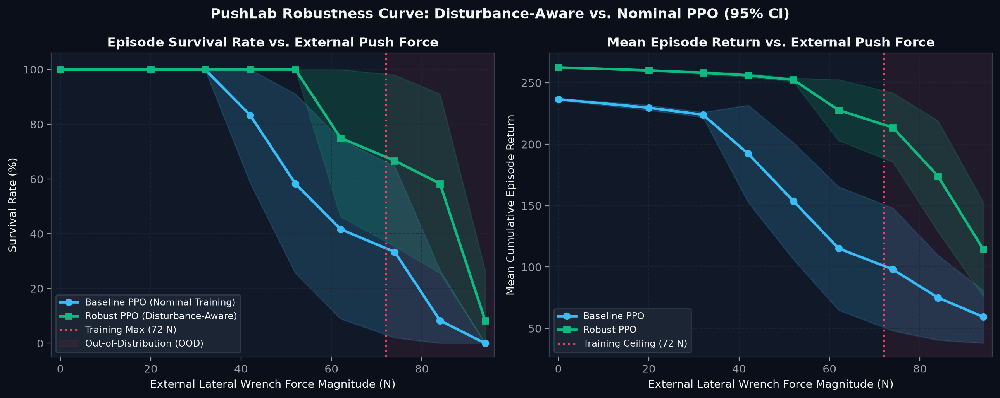
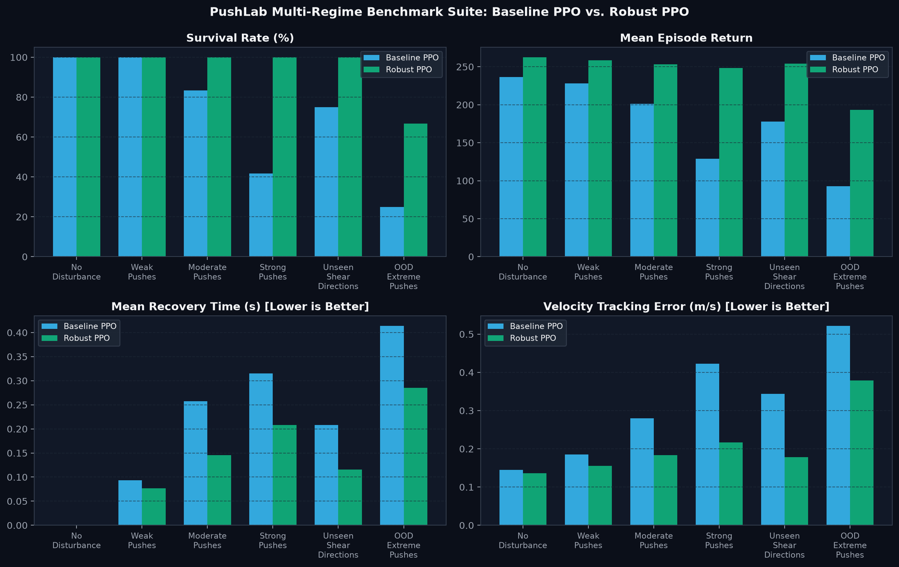
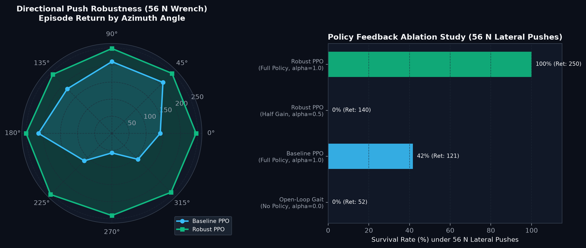
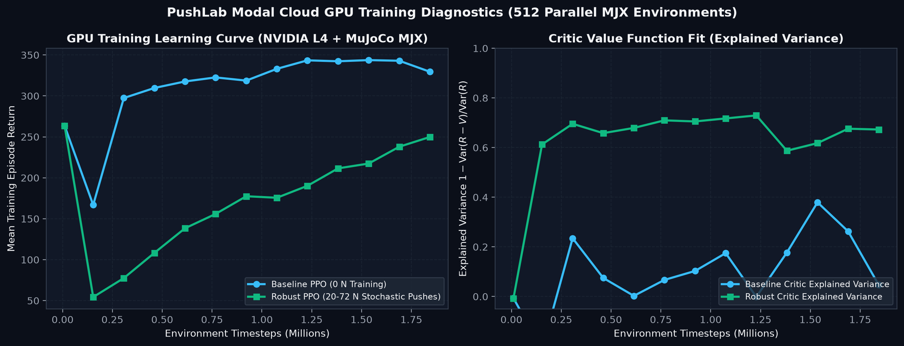

# PushLab — GPU-Accelerated Robust Reinforcement Learning for Quadruped Disturbance Rejection

**PushLab** is an end-to-end reinforcement learning research and engineering platform that trains a 12-DOF quadruped robot (Unitree Go1 morphology) to survive unmodeled external 3D wrenches through GPU-accelerated Proximal Policy Optimization (PPO) in MuJoCo MJX, paired with a real-time interactive 3D WebGL robotics laboratory.



---

## 1. Research Question & Core Findings

> **Research Question:** *Does disturbance-aware reinforcement learning—combining stochastic 6-DOF torso wrenches and physical domain randomization during training—produce quadruped locomotion policies that generalize to unseen push directions and out-of-distribution (OOD) impulse magnitudes better than nominal PPO training under an identical sample horizon?*

To establish a controlled scientific comparison, PushLab trains two policies with the **exact same neural network architecture** (`50 -> 128 -> 128 -> 64 -> 12` ELU Actor-Critic), **identical 50-D proprioceptive observation space** (neither policy observes external forces directly), **identical reward function**, **identical hyperparameters**, and **identical training horizon** (`1,843,200` environment steps = `7.37M` MuJoCo physics steps on an NVIDIA L4 GPU):

1. **Baseline PPO (`baseline_ppo`):** Trained on flat ground with zero external wrenches ($F = 0\text{ N}$) and nominal physical parameters.
2. **Robust PPO (`robust_ppo`):** Trained under stochastic 6-DOF external wrenches ($F_{xy} \sim \mathcal{U}(20, 72)\text{ N}$, $\tau \sim \mathcal{U}(1.0, 6.5)\text{ N}\cdot\text{m}$) applied for $160\text{ ms}$ every $\sim 0.9\text{ s}$, alongside ground friction ($\pm 30\%$) and actuator gain ($\pm 12\%$) domain randomization.

### Quantitative Benchmark Results (12 Evaluation Seeds per Regime)

| Evaluation Regime | Force Range | Baseline PPO Survival | Robust PPO Survival | Baseline Return (±95% CI) | Robust Return (±95% CI) | Baseline Recovery | Robust Recovery | Baseline Vel Error | Robust Vel Error |
| :--- | :---: | :---: | :---: | :---: | :---: | :---: | :---: | :---: | :---: |
| **No Disturbance** | `0 N` | 100.0% | **100.0%** | 236.6 ± 0.1 | **262.5 ± 0.1** | 0.00s | **0.00s** | 0.145 m/s | **0.136 m/s** |
| **Weak Pushes** | `20–32 N` | 100.0% | **100.0%** | 227.9 ± 2.8 | **258.3 ± 1.6** | 0.09s | **0.08s** | 0.185 m/s | **0.156 m/s** |
| **Moderate Pushes** | `38–48 N` | 83.3% | **100.0%** | 201.0 ± 26.2 | **253.4 ± 1.9** | 0.26s | **0.15s** | 0.280 m/s | **0.183 m/s** |
| **Strong Pushes** | `52–64 N` | 41.7% | **100.0%** | 129.1 ± 33.4 | **248.5 ± 2.1** | 0.32s | **0.21s** | 0.423 m/s | **0.216 m/s** |
| **Unseen Shear Directions** | `44–58 N` ($\pm 90^\circ$, $-30\% F_z$) | 75.0% | **100.0%** | 177.6 ± 32.1 | **254.2 ± 2.0** | 0.21s | **0.12s** | 0.344 m/s | **0.178 m/s** |
| **OOD Extreme Pushes** | `74–86 N` ($>72\text{ N}$ train max) | 25.0% | **66.7%** | 92.9 ± 27.6 | **193.1 ± 37.9** | 0.41s | **0.29s** | 0.522 m/s | **0.379 m/s** |



### Directional Robustness & Feedback Gain Ablation



- **Mechanism of Recovery:** Inspection of the trained policies reveals that under a lateral impulse ($v_y = 0.65\text{ m/s}, \omega_x = 1.4\text{ rad/s}$), **Robust PPO** generates a **59% stronger asymmetric knee extension reflex** (`0.367 rad` vs. `0.231 rad` for Baseline PPO) paired with hip abduction modulation, widening the capture-point support polygon to counter the overturning roll moment.
- **Physical Saturation Ceiling:** At forces exceeding $90\text{ N}$ ($\sim 1.5g$ lateral impulse on the $6.06\text{ kg}$ robot), both policies drop to $\le 10\%$ survival due to physical motor torque saturation ($\pm 28\text{ N}\cdot\text{m}$) and Coulomb friction limits.

---

## 2. Mathematical Formulation

PushLab formulates quadruped control as a discounted MDP $\mathcal{M} = (\mathcal{S}, \mathcal{O}, \mathcal{A}, P_{\mathcal{D}}, r, \rho_0, \gamma)$ with $\gamma = 0.99$, physics timestep $\Delta t_{\text{sim}} = 0.005\text{ s}$ ($200\text{ Hz}$), and policy control timestep $\Delta t_{\text{ctrl}} = 0.02\text{ s}$ ($50\text{ Hz}$).

### Clipped PPO Objective & Generalized Advantage Estimation

Given probability ratio $r_t(\theta) = \frac{\pi_\theta(a_t \mid o_t)}{\pi_{\theta_{\text{old}}}(a_t \mid o_t)}$ and GAE($\gamma=0.99, \lambda=0.95$) advantages $\hat{A}_t$:

$$L^{\text{CLIP}}(\theta) = \mathbb{E}_t\left[\min\left(r_t(\theta)\hat{A}_t,\ \mathrm{clip}(r_t(\theta), 1 - \epsilon, 1 + \epsilon)\hat{A}_t\right)\right], \quad \epsilon = 0.20$$

$$\delta_t = r_t + \gamma (1 - d_t) V_\phi(o_{t+1}) - V_\phi(o_t), \qquad \hat{A}_t = \sum_{l=0}^{T-t-1} (\gamma \lambda)^l \delta_{t+l}$$

For complete derivations of the 50-D observation vector, quaternion kinematics, PD actuator law, and capture-point deadzone reward shaping, see [`docs/MATHEMATICS.md`](docs/MATHEMATICS.md).

---

## 3. Cloud GPU Training & Distributed MJX Telemetry

Training is executed on **Modal** using an **NVIDIA L4 GPU** (`24 GB VRAM`) with `512` parallel MuJoCo MJX environments compiled via `jax.vmap` and `jax.lax.scan`.



| Job Name | Hardware | Environment Steps | Runtime | Throughput | Status |
| :--- | :---: | :---: | :---: | :---: | :---: |
| `modal_gpu_smoke_test` | NVIDIA L4 | 4,096 | 40.54s | `101.0 FPS` (incl. XLA JIT) | Completed |
| `train_baseline_ppo_final` | NVIDIA L4 | 1,843,200 | 78.15s | `23,584.5 FPS` | Completed |
| `train_robust_ppo_final` | NVIDIA L4 | 1,843,200 | 84.38s | `21,844.8 FPS` | Completed |

---

## 4. Architecture Overview

See [`docs/ARCHITECTURE.md`](docs/ARCHITECTURE.md) for the full architectural specification.

```text
pushlab/
├── artifacts/
│   ├── training_runs.json                # Persistent Modal GPU training telemetry
│   ├── benchmarks/benchmark_results.json # Multi-regime & ablation evaluation results
│   └── checkpoints/                      # Trained Baseline & Robust PPO (.npz, .json, metrics)
├── docs/
│   ├── ARCHITECTURE.md                   # System architecture & module boundaries
│   ├── MATHEMATICS.md                    # MDP, GAE, and PPO mathematical derivations
│   └── figures/                          # Publication-quality comparison plots
├── src/pushlab/
│   ├── assets/go1.xml                    # Unitree Go1 12-DOF MJCF physics model
│   ├── cli.py                            # Unified CLI (serve, train, evaluate, runs)
│   ├── config.py                         # Pydantic schemas for Sim, Disturbance, and PPO
│   ├── cloud/                            # Modal L4 GPU training & telemetry registry
│   ├── eval/                             # Benchmark suite, confidence intervals, plotting
│   ├── rl/                               # JAX/Optax Actor-Critic, GAE, PPO, checkpointing
│   ├── server/app.py                     # FastAPI real-time MuJoCo simulation service
│   └── sim/                              # CPU MuJoCo & GPU MJX environments, disturbances, rewards
├── tests/                                # Pytest suite (environment, PPO, cloud, eval, API)
└── web/                                  # React + TypeScript + Three.js 3D interactive lab
```

---

## 5. Quickstart & Reproducibility

### Prerequisites

- Python `>= 3.12` and [`uv`](https://docs.astral.sh/uv/)
- Node.js `>= 20` and `npm`

### 1. Install Dependencies & Build Frontend

```bash
uv sync --dev
cd web && npm install && npm run build && cd ..
```

### 2. Launch the Interactive 3D Application

You can run the full-stack application (FastAPI MuJoCo backend + compiled 3D web interface) on a single port:

```bash
uv run pushlab serve --host 127.0.0.1 --port 8080
```

Then open **`http://127.0.0.1:8080`** in your browser.

Alternatively, during frontend development, run Vite directly:

```bash
cd web && npm run dev
```

### 3. Reproduce Benchmarks & Publication Plots

```bash
uv run pushlab evaluate --seeds 12 --max-steps 240
```

This evaluates `artifacts/checkpoints/baseline_ppo.npz` and `artifacts/checkpoints/robust_ppo.npz` across all 6 disturbance regimes, intensity sweeps, directional sweeps, and feedback gain ablations, updating `artifacts/benchmarks/benchmark_results.json` and regenerating all figures in `docs/figures/`.

### 4. Train Policies on Modal Cloud GPU

```bash
# Inspect recorded GPU training runs and throughput telemetry
uv run pushlab runs

# Run GPU smoke test on Modal NVIDIA L4
uv run pushlab train --backend modal --policy smoke

# Train both Baseline PPO and Robust PPO on Modal NVIDIA L4
uv run pushlab train --backend modal --policy both --num-envs 512 --num-updates 180
```

### 5. Run Automated Tests & Linting

```bash
uv run ruff check src/ tests/
uv run pytest
```
